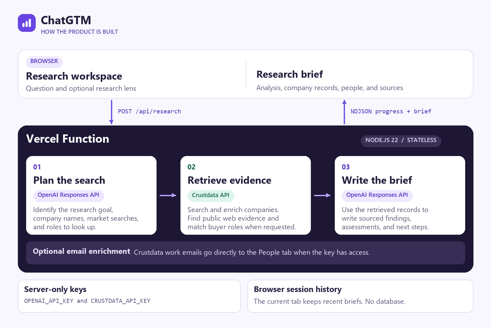

# ChatGTM

## The service

ChatGTM is a B2B market research assistant for founders, growth teams, and sales teams. Ask a question in plain English and get a brief that connects market and company evidence to a decision. For example, ask how to enter India's mid-market with an accounts payable product or who buys that product at logistics companies.

## What it does now

| Research lens | Output |
| --- | --- |
| Company intelligence | A company profile with available firmographics, commercial signals, buyer segments, and risks |
| Market entry and GTM | A proposed first segment, positioning, sales channels, and a pilot with success metrics |
| Competitor analysis | A comparison of direct rivals, substitutes, tradeoffs, and positioning opportunities |
| Customer discovery | A shortlist of potential buyers, relevant decision-makers, professional profiles, and deliverable work emails when available |

Each live brief shows the retrieved records, links to available sources, and coverage gaps. Findings identify evidence, assessments, and recommendations. The workspace also shows progress, supports cancellation, and downloads briefs as Markdown. Four fictional sample briefs can be opened without API keys.

## What comes next

1. Run the same benchmark questions with live provider keys and score source relevance, factual accuracy, and buyer-role fit.
2. Improve prospect ranking by asking for the ideal customer profile, qualifying accounts against selected criteria, and explaining why each ranked account fits.
3. Add follow-up questions that reuse a brief's cited records for deeper research.

## How it runs



### Try it locally

Clone this repository, then open a terminal in the project folder. Use Node.js 22.

```powershell
npm run dev
```

Open [the local workspace](http://127.0.0.1:3000) and click **Find potential customers** to see a sample brief with its Companies, People, and Sources tabs. To enable live requests, copy `.env.example` to `.env.local`, add the two API keys, and restart the server.

### Deploy on Vercel

Import this GitHub repository as a Vercel project. Keep the root directory at `.`, use the **Other** framework preset and **Node.js 22.x**, and add these values under **Settings → Environment Variables** for the deployment environment.

| Variable | Secret value |
| --- | --- |
| `CRUSTDATA_API_KEY` | Your Crustdata API key |
| `OPENAI_API_KEY` | Your OpenAI API key |

Set `OPENAI_MODEL` only if you want to override the `gpt-5.4-mini` default. Keep provider keys in the local environment file or Vercel's environment settings. Use a protected Vercel deployment when sharing a demo that uses billable credentials.

Vercel serves [the browser app](public/) and runs [the research function](api/research.js). The function asks OpenAI to plan the search, retrieves evidence through [Crustdata](lib/crustdata.js), and asks OpenAI to write a structured brief from the evidence. Progress and the finished brief stream back as NDJSON. The browser keeps recent briefs in its current tab session.

## What you tried

- Tested the sample workspace in Chrome at desktop and mobile sizes, including opening a brief, viewing contacts, following a citation, reopening a recent brief, and submitting a question while the keys were unset.
- Exercised the real API handler with mocked provider responses. Verified name matching, shortlist and role filtering, progress streaming, citation validation, deliverable email handling, denied email access, and insufficient credits.
- Checked the request and response shapes against the OpenAI and Crustdata documentation. Live provider calls and a Vercel deployment still need verification with credentials. [OpenAI Responses API](https://developers.openai.com/api/reference/resources/responses/methods/create) · [Crustdata API docs](https://docs.crustdata.com/)

## Why this way

A bounded research flow fits the hackathon build and keeps provider calls predictable. The planning step translates different questions into specific searches. That separation lets the app display the evidence directly, label inferences, and preserve useful records when an optional lookup fails.

A browser frontend and one Node.js Vercel Function keep deployment simple. API keys stay server-side and brief history lives in the browser session. There is no database or package installation step.

Contact enrichment runs for a small shortlist when the question calls for contact details. The app uses deliverable work emails returned by Crustdata and shows professional profile links when the key lacks email access or no address is available. [Crustdata Contact Enrichment](https://docs.crustdata.com/person-docs/contact/enrich)
